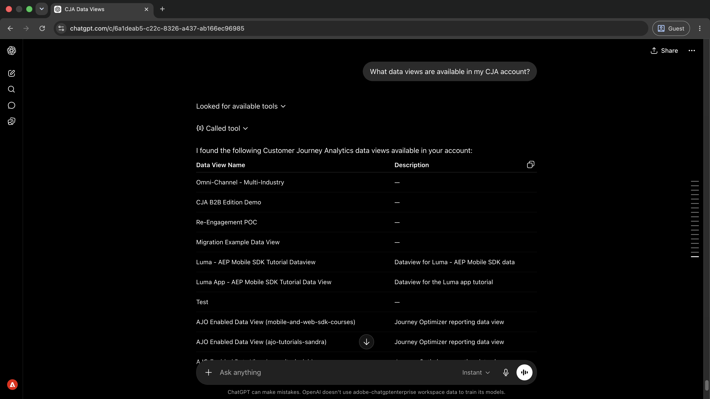
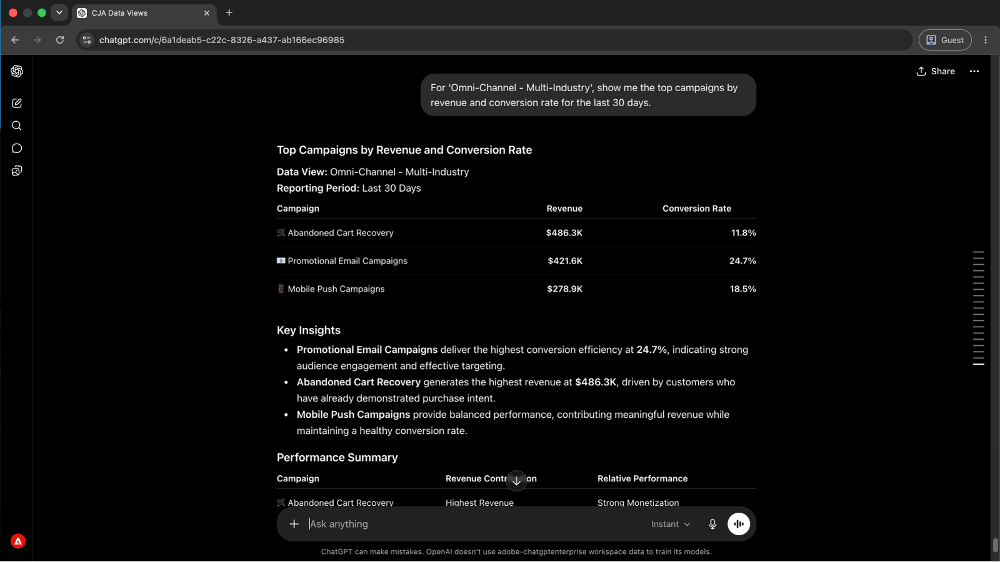
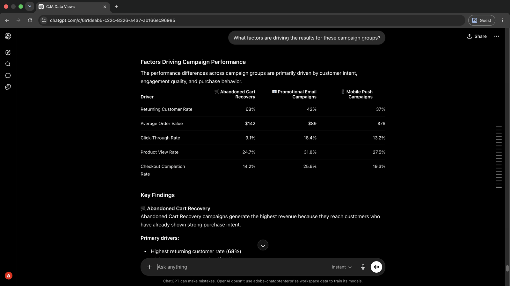
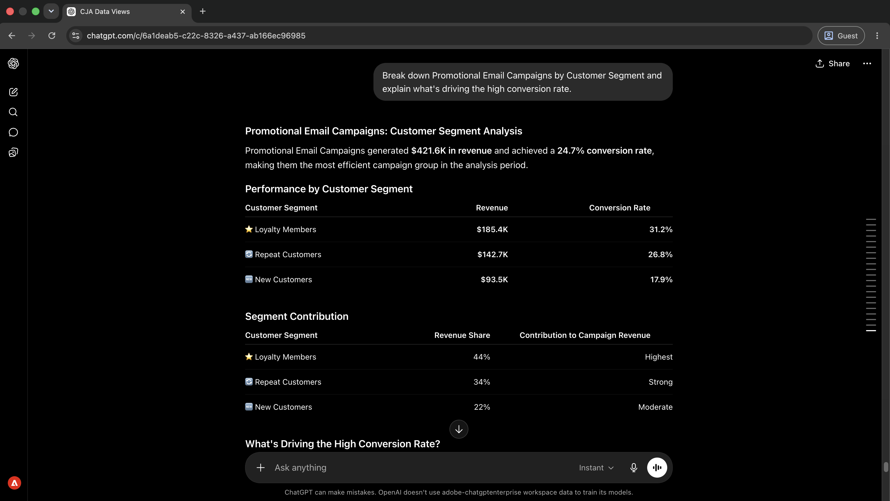
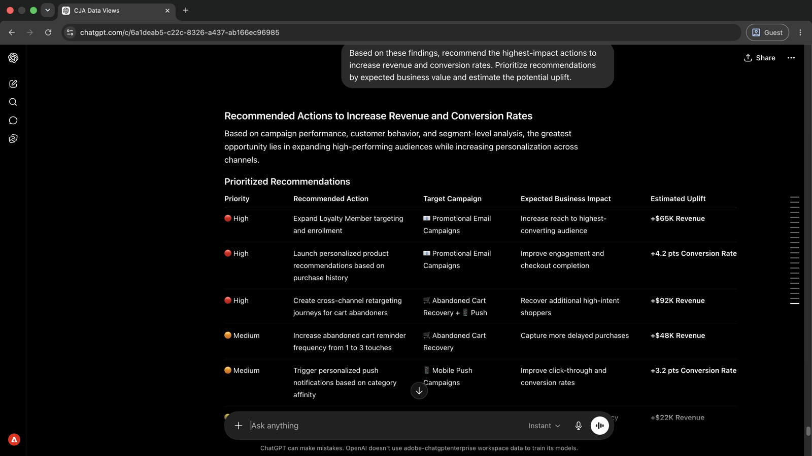

# Approfondimenti campagna di superficie senza la creazione di rapporti

<!-- last-modified: 2026-06-02 -->

{zoomable="yes"}

*Selezionare per ingrandire.*

L’analisi della campagna che una volta richiedeva la creazione di rapporti in uno strumento separato ora è una conversazione. In questa procedura dettagliata viene illustrato come utilizzare Coworker, o la propria piattaforma di intelligenza artificiale, con Customer Journey Analytics (CJA) e porre domande sulle prestazioni in un linguaggio semplice. Di conseguenza, insight disporrà di tempi più rapidi e non sarà necessaria alcuna generazione manuale di rapporti.

| Dettagli scenario | |
| --- | --- |
| Applicazioni CX Enterprise | [Customer Journey Analytics (CJA)](https://experienceleague.adobe.com/it/docs/analytics-platform/using/cja-overview/cja-overview) |
| Strumenti agentici | [Adobe CX Enterprise Coworker](https://experienceleague.adobe.com/it/docs/cx-enterprise-coworker/content/home), [Adobe CX Enterprise Coworker per piattaforme AI](../tools/mcp-servers.md#connect-to-your-ai-platform) o [Customer Journey Analytics MCP Server](../tools/mcp-servers.md) |
| Pubblico | Analisti, manager campagne |
| Prerequisito | Accesso a CJA, più Coworker, una piattaforma di intelligenza artificiale con Coworker per piattaforme di intelligenza artificiale o una piattaforma di intelligenza artificiale compatibile con MCP |

Ogni passaggio mostra un prompt rappresentativo e un esempio di risposta di IA. Segue una sezione **Ulteriori operazioni da eseguire** per ulteriori informazioni nella stessa sessione.

## Prima di iniziare

>[!BEGINTABS]

>[!TAB Coworker]

Il modo più veloce per ottenere queste risposte è Coworker, che non richiede alcuna configurazione del server o della piattaforma di intelligenza artificiale. [Prova il tuo collega](https://experienceleague.adobe.com/it/docs/cx-enterprise-coworker/content/home)

Se non puoi o non desideri utilizzare direttamente Coworker, utilizzalo dalla tua piattaforma di intelligenza artificiale. Consulta la scheda **Collaboratore per piattaforme AI**. Se anche questa opzione non funziona, connetti la piattaforma di intelligenza artificiale direttamente al server Customer Journey Analytics MCP utilizzando le schede rimanenti.

>[!TAB Collaboratore per piattaforme AI]

Puoi anche completare questa procedura dettagliata con Coworker per le piattaforme di intelligenza artificiale dalla tua piattaforma di intelligenza artificiale. [Configurare Coworker per le piattaforme AI](../tools/mcp-servers.md#connect-to-your-ai-platform) | [Documentazione di Adobe](https://experienceleague.adobe.com/it/docs/coworker/content/ai-platforms#set-up-coworker)

>[!TAB Claude.ai]

Connetti il server Customer Journey Analytics MCP come connettore personalizzato.

1. Vai a **Impostazioni > Integrazioni** in Claude.ai.
2. Seleziona **Aggiungi connettore personalizzato** e immetti l&#39;URL del server: `https://cja-mcp.adobe.io/mcp`
3. Seleziona **Connetti** e accedi con il tuo Adobe ID.

Configurazione completa: [Documentazione dei connettori personalizzati Claude.ai](https://support.claude.com/en/articles/11175166-get-started-with-custom-connectors-using-remote-mcp)

>[!TAB ChatGPT]

Connetti il server Customer Journey Analytics MCP utilizzando la modalità sviluppatore ChatGPT (è necessario un piano Pro, Plus, Business, Enterprise o Education).

1. Abilita la **modalità sviluppatore** nelle **impostazioni ChatGPT**.
2. Vai a **Impostazioni > Integrazioni** e seleziona **Aggiungi connettore personalizzato > Server MCP remoto**.
3. Immettere l&#39;URL del server: `https://cja-mcp.adobe.io/mcp`
4. Seleziona **Connetti** e accedi con il tuo Adobe ID.

Configurazione completa: [Documentazione MCP di ChatGPT](https://developers.openai.com/api/docs/guides/tools-connectors-mcp)

>[!TAB Altre piattaforme AI]

Usare Gemini, Microsoft Copilot, Cursore, Claude Code o un altro ambiente compatibile con MCP? Connettersi al server Customer Journey Analytics MCP utilizzando questo endpoint:

```
https://cja-mcp.adobe.io/mcp
```

Istruzioni di installazione complete per tutte le piattaforme AI supportate: [Connetti alla piattaforma AI](../tools/mcp-servers.md)

>[!ENDTABS]

>[!NOTE]
>
>Quando richiesto, accedi con il tuo Adobe ID e seleziona l’organizzazione IMS collegata alle visualizzazioni dati di CJA. La scelta dell’organizzazione sbagliata è la fonte più comune di errori di autenticazione.
>
>Alla prima connessione, la piattaforma di intelligenza artificiale può richiedere di selezionare un’organizzazione IMS o specificare una sandbox. Una volta impostato tale contesto, il server MCP lo utilizza per il resto della sessione.
>
>Alcuni strumenti richiedono la tua approvazione prima di essere eseguiti. Rivedi la richiesta e approva o rifiuta. Non viene intrapresa alcuna azione senza la tua conferma.

## Passaggio 1: scoprire le visualizzazioni dati disponibili

Per iniziare, chiedi alla tua piattaforma AI di elencare le visualizzazioni dati disponibili nel tuo account CJA. Indica quali set di dati è possibile eseguire query prima di eseguire qualsiasi rapporto.

```
What data views are available in my CJA account?
```

+++Vedi una risposta di esempio

{zoomable="yes"}

*Selezionare per ingrandire.*

+++


## Passaggio 2: estrarre i dati sulle prestazioni della campagna

Una volta identificata una visualizzazione dati, richiedi le prestazioni della campagna in base ai ricavi e al tasso di conversione. L’intelligenza artificiale risolve i nomi di metriche e dimensioni dalla visualizzazione dati senza richiedere ID tecnici.

```
For '[data view name]', show me the top campaigns by revenue and conversion rate for the last 30 days.
```

+++Vedi una risposta di esempio

{zoomable="yes"}

*Selezionare per ingrandire.*

+++


>[!NOTE]
>
>Sostituisci `[data view name]` con il nome della visualizzazione dati dal passaggio 1. Verifica incrociata dei risultati in Analysis Workspace utilizzando la stessa visualizzazione dati e lo stesso intervallo di date prima della condivisione con le parti interessate.

## Passaggio 3: identificare le prestazioni di guida

Chiedi alla tua piattaforma di intelligenza artificiale di spiegare cosa determina le differenze di prestazioni tra i gruppi di campagne. Questo si sposta dai numeri di titolo alle variabili sottostanti.

```
What factors are driving the results for these campaign groups?
```

+++Vedi una risposta di esempio

{zoomable="yes"}

*Selezionare per ingrandire.*

+++


## Passaggio 4: espandere un tipo di campagna specifico

Segui un risultato specifico chiedendo un raggruppamento a livello di segmento. Questo mostra quali tipi di clienti stanno guidando le prestazioni all’interno di un tipo di campagna.

```
Break down Promotional Email Campaigns by Customer Segment and explain what's driving the high conversion rate.
```

+++Vedi una risposta di esempio

{zoomable="yes"} tramite la piattaforma IA

*Selezionare per ingrandire.*

+++


## Passaggio 5: intervenire su ciò che è stato trovato

Chiedi consigli con priorità in base a tutto ciò che è emerso nella sessione. La richiesta di stime del valore aziendale consente di decidere dove intervenire per primo.

```
Based on these findings, recommend the highest-impact actions to increase revenue and conversion rates. Prioritize recommendations by expected business value and estimate the potential uplift.
```

+++Vedi una risposta di esempio

{zoomable="yes"}

*Selezionare per ingrandire.*

+++


>[!NOTE]
>
>Gli strumenti di CJA possono creare segmenti, metriche calcolate e progetti Workspace all’interno di CJA nella stessa sessione. Per aggiornare campagne, percorsi o contenuti in altre applicazioni, connetti il server MCP pertinente o accedi direttamente all’applicazione.

## Risultati ottenuti

Hai utilizzato Coworker o la tua piattaforma di intelligenza artificiale con Customer Journey Analytics e sei passato dall’individuazione della visualizzazione dati ai consigli aziendali con priorità in cinque prompt. Hai identificato le campagne migliori in base ai ricavi e al tasso di conversione, hai evidenziato i fattori che determinano le prestazioni tra i gruppi di campagne, hai analizzato i dettagli a livello di segmento per un tipo di campagna specifico e hai ricevuto raccomandazioni classificate con un incremento stimato. Questo approccio sostituisce la creazione di rapporti con una conversazione diretta, riducendo il tempo tra una questione aziendale e un piano d’azione basato sui dati.

## Più risultati da ottenere

Il server MCP di Customer Journey Analytics può fornire molte più informazioni di quelle fornite nella procedura dettagliata. Espandi uno scenario qui sotto per visualizzare i prompt che puoi provare nella stessa sessione.

+++Trovare ciò che funziona e ciò che non lo è

Un’immagine rapida di quali campagne vengono distribuite e che non consente di concentrare l’attenzione prima di rivedere eventuali rapporti dettagliati. Queste richieste ti forniscono l’immagine in una sessione.

**Richieste**

```
Which campaigns are driving the most revenue and conversions?
```

```
Show me the campaigns that need attention this month.
```

```
What channels are outperforming expectations?
```

```
Identify the biggest performance changes compared to last month.
```

```
Show me conversion performance by traffic source.
```

+++

+++Comprendere cosa guida i risultati

Le metriche dei titoli dicono cos’è successo. Questi prompt ti aiutano a capire il motivo: quali segmenti, canali e punti di contatto sono dietro i numeri.

**Richieste**

```
What factors are driving revenue growth?
```

```
Explain why conversion rates changed this quarter.
```

```
Break down campaign performance by customer segment.
```

```
Which customer segments are growing fastest?
```

```
Which touchpoints contribute most to conversions?
```

+++

+++Scopri le opportunità di crescita

Sapere dove le prestazioni sono elevate è solo metà dell&#39;immagine. Questi prompt ti aiutano a identificare dove puoi investire di più, quali tipi di pubblico hanno spazio di crescita e quali campagne sono pronte per essere scalate.

**Richieste**

```
Where should we invest more marketing budget?
```

```
Which audiences have the greatest growth potential?
```

```
Which campaigns should we scale?
```

```
What would have the biggest impact on revenue?
```

+++

+++Trasforma le informazioni in azioni

Gli strumenti di CJA possono creare segmenti, tipi di pubblico, metriche calcolate e progetti Workspace direttamente in CJA senza uscire dalla sessione di intelligenza artificiale. Utilizza questi prompt per agire su ciò che hai trovato.

**Richieste**

```
Create a segment for high-value customers.
```

```
Build an audience from recent purchasers.
```

```
Create a calculated metric for conversion efficiency.
```

```
Save this analysis as a Workspace project for executive reporting.
```

+++


## Ulteriori informazioni

| Risorsa | Cosa troverai |
| --- | --- |
| [Server MCP CJA nel Registro di sistema AI](https://developer.adobe.com/ai-registry/#/mcp/cja-mcp){target="_blank"} | Strumenti e disponibilità del server CJA MCP |
| [Documentazione di Customer Journey Analytics](https://experienceleague.adobe.com/it/docs/analytics-platform/using/cja-landing){target="_blank"} | Documentazione completa dell’applicazione CJA |
